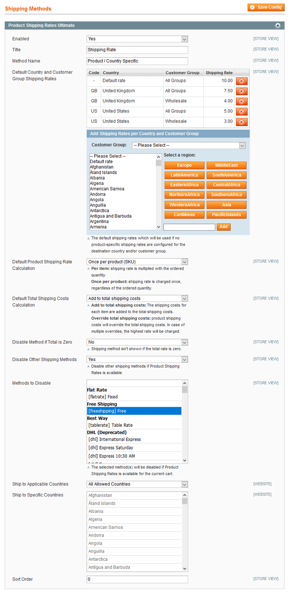

# Configuring the Product Shipping Rates Extension

To configure the extension's general and default shipping rate settings, navigate to **System > Configuration** in the top Admin Panel menu and select **Shipping Methods** from the left side menu.

Using the Product Shipping Rates Ultimate section you can:

- Enable the extension to use the shipping method in the Admin Panel and front-end store.
- Modify the shipping method title and name which are shown in the shopping cart.
- Configure the default product, country and customer shipping rates and calculation options as further explained below. You can also specify the shipping rates per product in the [Shipping Rates Ultimate tab](./05-configuring-shipping-rates-per-product.md) of the product view.
- Choose to disable the shipping method if the total rate is zero, for instance when the shopping cart contains products without Product Shipping Rates configured.
- Choose to disable other shipping methods when Product Shipping Rates is available for products in the shopping cart. If this option is enabled, you can select the shipping method(s) that should be disabled.
- Choose to enable the shipping method for all allowed countries or specific countries only using the 'Ship to Applicable Countries' option.
- If applicable, select the allowed destination countries for the shipping method at 'Ship to Specific Countries'.
- If specific countries are selected, you can choose to show or hide the shipping method for not applicable countries.
- When multiple shipping methods are enabled, you can define the sort order, starting with 0.

It's possible to configure the shipping method per store view by changing the 'Current Configuration Scope' at the top left corner of the page.

To save any changes made in the Product Shipping Rates Ultimate settings, click the 'Save Config' button in the top right corner of the configuration page.

## Default Country and Customer Group Shipping Rates

The shipping rates added at 'Default Country and Customer Group Shipping Rates' are used for products without specific country and customer shipping rates.

To configure the default product shipping rates, select a customer group from the dropdown menu, then select one or multiple countries from the list box. Enter the shipping rate in the input field and click 'Add' or press 'Enter'.

You can use the integrated presets to automatically select multiple countries in the same region.

Select 'All Groups' from the dropdown menu to add a default shipping rate for all customer groups. This default group rate is overridden by any specific customer group shipping rate.

Select 'Default rate' from the country list box to add a default shipping rate for all destination countries. This default country rate is overridden by any specific country shipping rate.

## Default Product Shipping Rate Calculation

There are two options to calculate product shipping rates: per item or per product/SKU.

- **Per item**: the product shipping rate is multiplied with the ordered quantity. So if 5 items are ordered with a shipping rate of $2, the total product shipping costs will be $10.
- **Once per product**: the product shipping rates are fixed, regardless of the ordered quantity. So if 5 items are added to the order with a shipping rate of $2, the total product shipping costs will remain $2.

## Default Total Shipping Costs Calculation

There are also two options to calculate the total shipping costs in the shopping cart: the product shipping rates can be added up to the total or override it.

- **Add up to total shipping costs**: the individual product shipping rates are added up to the total shipping costs. For example, when adding a product with a shipping rate of $10 to an order with a shipping subtotal of $5. the total shipping costs are $15.
- **Override total shipping costs**: the total shipping costs are overridden by the highest product shipping rate. Following the example above, the product shipping rate of $10 would override the $5 shipping subtotal, making the total shipping costs $10.

---

[Documentation index](./README.md) · [README](../README.md) · [Online version](https://plugin.company/knowledge-base/docs/magento-product-shipping-rates-ultimate/user-manual/configuring-the-product-shipping-rates-extension/)
