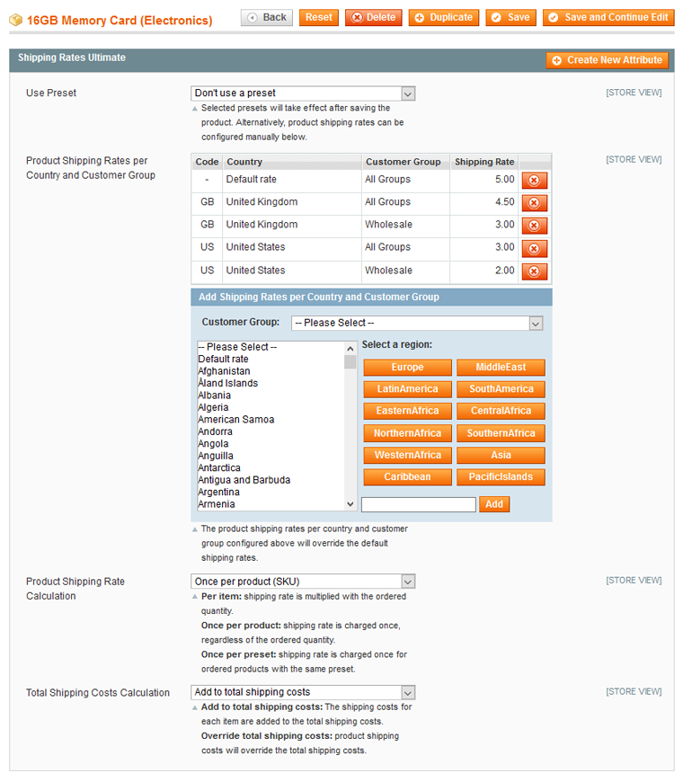

# Configuring Shipping Rates Per Product

To specify the country / customer group shipping rates and calculation options per product, navigate to **Catalog > Manage Products**, select a product from the list and click **Shipping Rates Ultimate** in the left side menu.

Using the Shipping Rates Ultimate tab in the product view you can:

- Automatically configure the product shipping rates using a custom shipping rate preset.
- Configure the product shipping rates per country and customer group.
- Configure the shipping rate calculation options.

## Using Shipping Rate Presets

If you have created [custom shipping rate presets](./06-configuring-product-shipping-rate-presets.md) you can select one from the preset dropdown menu at the top of the Shipping Rates Ultimate tab.

The selected preset will take affect after the product has been saved, updating the shipping rates and calculation options in the Shipping Rates Ultimate tab accordingly.

Alternatively you can configure the product shipping rates manually using the options below.

## Product Shipping Rates Per Country and Customer Group

The shipping rates configured for a specific product will automatically override the [default country and customer group shipping rates](./04-configuring-the-product-shipping-rates-extension.md#shipping-rates) added in the extension's config screen.

To add product shipping rates, select a customer group from the dropdown menu, then select one or multiple countries from the country list box. Enter the shipping rate in the input field and click 'Add' or press 'Enter'.

You can use the integrated presets to automatically select multiple countries in the same region.

Select 'All Groups' from the dropdown menu to add a default product shipping rate for all customer groups.

Select 'Default rate' from the country list box to add a default product shipping rate for all destination countries.

## Product Shipping Rate Calculation

The product shipping rate can be calculated per item or once per product as explained in [Configuring the Product Shipping Rates Extension](./04-configuring-the-product-shipping-rates-extension.md#product-shipping).

Besides that, you can also choose to calculate the shipping rate **once per preset**, meaning that the preset rate will be charged only once for all preset products that are added to the cart.

Select 'Use default config' to use the default product shipping rate calculation method.

## Total Shipping Costs Calculation

The product shipping rate can be added up to the total shipping costs or override them as explained in [Configuring the Product Shipping Rates Extension](./04-configuring-the-product-shipping-rates-extension.md#total-shipping).

Select 'Use default config' to use the default total shipping costs calculation method.

---

[Documentation index](./README.md) · [README](../README.md) · [Online version](https://plugin.company/knowledge-base/docs/magento-product-shipping-rates-ultimate/user-manual/configuring-shipping-rates-per-product/)
