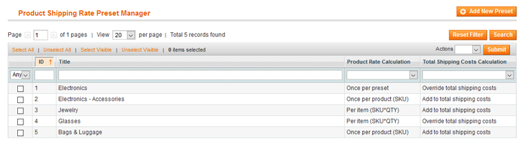
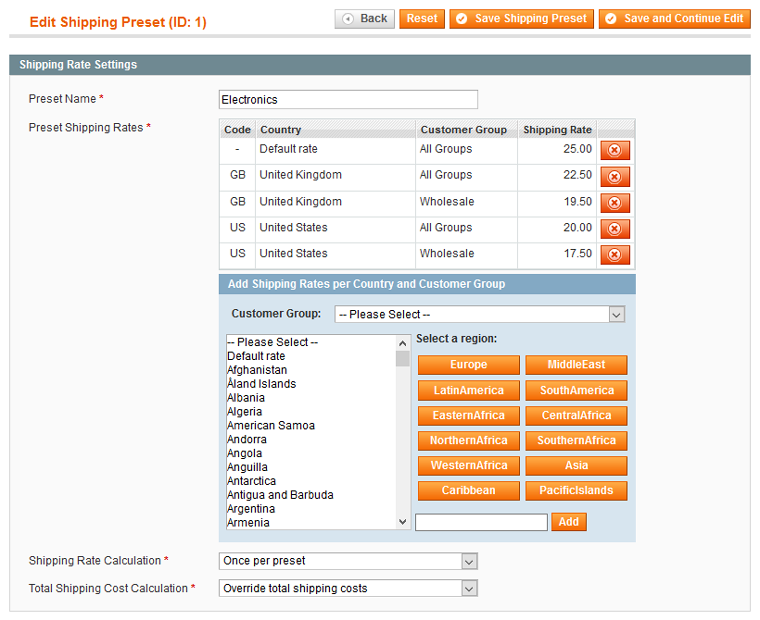
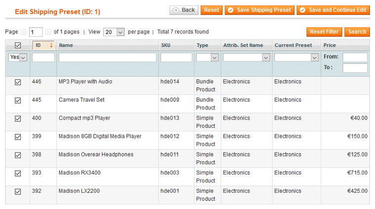

# Configuring Product Shipping Rate Presets

If you want to quickly configure the same shipping rates for multiple products at once, such as products of the same type, attribute set or price category, you can create custom shipping rate presets by navigating to **Catalog > Product Shipping Rate Presets** in the top Admin Panel menu.

Create a new shipping rate preset by clicking the 'Add New Preset' button in the top right corner of the page.

Using the tabs in the Preset Information menu you can configure the preset shipping rate settings and products as further explained below.

After saving the preset, the configured shipping rates and calculation options will be automatically updated in the [Shipping Rates Ultimate tab](./05-configuring-shipping-rates-per-product.md) of the preset products as well.

## Shipping Rate Settings

In the Shipping Rate Settings tab you can enter a preset name and configure the country / customer group shipping rates and calculation methods.

## Preset Products

Using the Preset Products you can select the applicable products for the shipping rate preset.

The product grid includes an extra column for filtering products by current preset (if available).

---

[Documentation index](./README.md) · [README](../README.md) · [Online version](https://plugin.company/knowledge-base/docs/magento-product-shipping-rates-ultimate/user-manual/configuring-product-shipping-rate-presets/)
